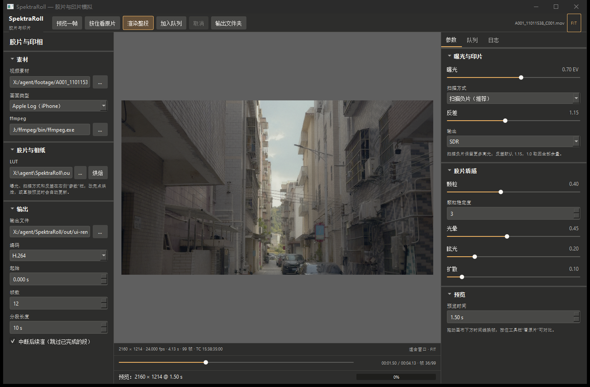
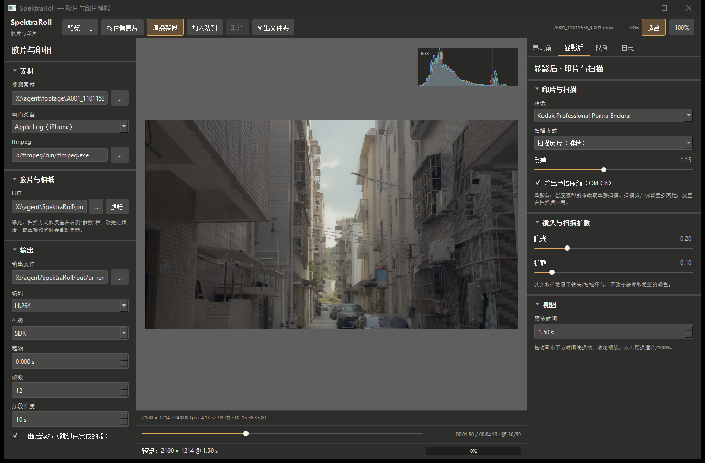
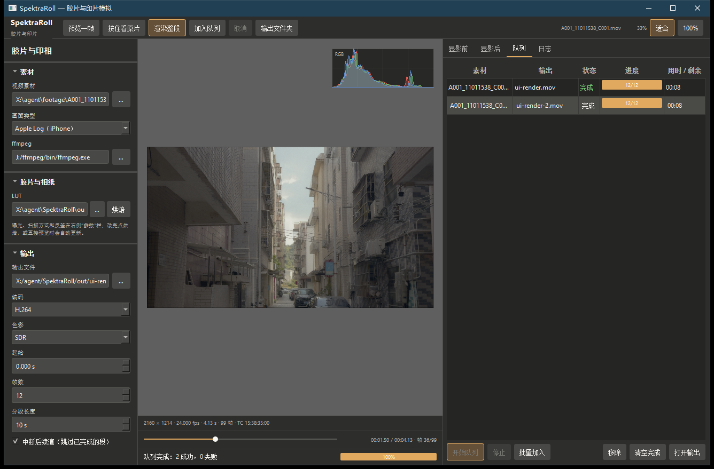

# SpektraRoll

[](https://github.com/haichangjyue/SpektraRoll/actions/workflows/build.yml)

Open-source spectral film simulation for **motion picture**.

Status: **M5 in progress** — the M1 spectral chain bakes a real **Kodak Portra 400
+ Portra Endura** LUT with parity against the upstream Python model at
**PSNR 88 dB** (ΔE76 max 0.0065), accepts **Apple Log**, **Sony S-Log3**
(S-Gamut3.Cine or S-Gamut3), **Canon C-Log3**, **Panasonic V-Log**,
**ARRI LogC3 / LogC4**, **Blackmagic Film Gen 5** and **DaVinci Intermediate**
footage as input, can print it (`--scan print`), scan the negative
(`--scan negative`, much more latitude), or scan a reversal film directly
(`--scan slide`, Ektachrome / Velvia / Provia / Kodachrome),
writes SDR or **HDR (PQ/HLG)** as 16-bit PNG or unclipped **float/half EXR**,
and renders clips in resumable segments while keeping the camera timecode. A
**Qt 6 desktop UI** wraps the same pipeline. Colour management is optional:
linking **OpenColorIO** turns any camera or ACES space into a valid LUT domain
and enables ACES display views.

Repo: https://github.com/haichangjyue/SpektraRoll



## What this will become

A film-and-print simulator for video: light traced through 81 wavelengths,
through a virtual negative, an enlarger and a print, then scanned — the same
physical model as [spektrafilm](https://github.com/andreavolpato/spektrafilm),
but built for clips instead of stills.

```
scene → [camera + film] → latent image → [development] → negative densities
      → [enlarger + paper] → latent print → [development] → print densities
      → [scan] → display RGB
```

The colour part of that chain is baked into a 3D LUT and evaluated per pixel;
the spatial parts (grain, halation, diffusion, glare) run per frame and stay
out of the LUT. That split is what makes video tractable.

## Build

Windows:

```powershell
.\scripts\dev-install.ps1   # once, no admin rights needed
.\scripts\build.ps1
.\scripts\demo.ps1          # synthetic LUT smoke test
.\scripts\demo-m1.ps1       # the real film LUT, before/after images
```

Or double-click `scripts\dev-install.cmd`, `scripts\build.cmd`,
`scripts\demo-m1.cmd`. `scripts\verify-m1.cmd` is the one-button acceptance
check (build + tests + bake + parity).

macOS / Linux:

```bash
cmake -S . -B build -G Ninja -DCMAKE_BUILD_TYPE=Release
cmake --build build
ctest --test-dir build --output-on-failure
# CI also bakes the M1 LUT and compares it to the frozen reference here;
# re-running the full parity against the upstream Python model needs the
# upstream checkout and Python, see tools/parity/README.md
```

### OpenColorIO (optional, D062)

The colour management layer is optional. With a config you can use any camera
or ACES space as the LUT domain, and render display views:

```bash
# macOS
brew install opencolorio
cmake -S . -B build -DCMAKE_PREFIX_PATH="$(brew --prefix)"   # finds OpenColorIO

# Windows (MinGW): no package exists, so build the static prefix once
tools\ocio\build-ocio.cmd

# both: prove it is there, then bake a LUT in an ACES camera space
spektra-roll-cli ocio-info --ocio-config data/ocio/studio-config-v3.0.0_aces-v2.0_ocio-v2.4.ocio
spektra-roll-cli lut bake --ocio-config data/ocio/studio-config-v3.0.0_aces-v2.0_ocio-v2.4.ocio \
    --ocio-input "ARRI LogC3 (EI800)" --scan negative --out logc3.cube
```

`-DSR_WITH_OCIO=OFF` (or a machine without the library) compiles a stub: the
tool works exactly as before and `--ocio-*` explains that this build has no
OpenColorIO. The baked LUT carries the decode, so `lut apply` and `video` never
need the library. `data/ocio/` ships the ACES 2.0 studio config (Apache-2.0).

`ocio-info --json` prints the same information for the Qt UI (D063), which lists
the config's colour spaces in the OCIO section instead of linking the library.

## Desktop UI (Qt 6)

The Windows shell is Qt 6 Widgets (D009); the CLI keeps working without it.
It only drives `spektra-roll-cli` — preview extracts one frame with ffmpeg and
grades it with `lut apply`, Render streams the CLI log and progress — so the UI
cannot drift from the pipeline CI tests.

```powershell
.\scripts\build-ui.cmd          # configure + build + windeployqt + launch
```

Qt 6.8.3 and MinGW 13.1 are expected under `X:\agent\tools\qt` (installed with
`aqtinstall`, not vendored). Qt is dynamically linked (LGPL-3.0/GPL-3.0);
`windeployqt` copies the runtime next to the executable.

The **色彩管理（OCIO）** section (D063) reads a `.ocio` config through
`spektra-roll-cli ocio-info --json` and lists every colour space; with it on,
Bake and the spectral preview pass `--ocio-config/--ocio-input` to the same CLI,
and "hold to compare" decodes the source through OCIO too. The UI never links
OpenColorIO: it prefers the full CLI in `build/` (which has it) and can be
pointed elsewhere with `SPEKTRA_CLI`. `build-ui\spektra-roll-ui.exe
--ocio-selftest` bakes an Apple Log LUT without clicking.

Renders can be queued: **加入队列** freezes the current arguments and copies the
LUT, outputs that would collide get a `-2`, `-3` suffix, and the queue runs the
jobs one after another with per-job progress bars, elapsed/remaining time, and
status. The queue is saved to `out/ui-queue/queue.json` and restored on the next
launch; dropping several clips at once (or **批量加入**) enqueues one job per clip.

The three-column layout and theme follow a study of
[SpektraLab](https://github.com/JamesQiu2005/SpektraLab) (GPL-3.0); only layout
structure and colour tokens were adopted, no source or assets copied. Notes:
`docs/ui-analysis-spektralab.md`. The canvas has an RGB histogram overlay and
fit/100% zoom (wheel, drag, double-click, Ctrl+0/1). The inspector is split the
way a lab works: **显影前** holds exposure, film, DIR couplers and emulsion
effects; **显影后** holds paper, scan mode, contrast, gamut compression and
lens/scan diffusion. The film and paper pickers list 16 colour negative stocks
(11 still-photo plus Vision3/Verita) and 8 second mediums (6 papers and the
2383/2393 cinema print films); choosing a film auto-selects its recommended
paper or print film.

Colour normally runs as a baked 3D LUT. `--engine spectral` (CLI, or **引擎** in
the UI) bypasses the LUT and runs the per-pixel film/paper chain directly:
measured on this machine, **1.08 s per 2.6 MP still** and **1.26 s per video
frame** (12 threads). It is the fully physical option for short/final renders;
the LUT stays the default for interactive preview and long clips. On the same
frame the 33³ LUT and the physical path agree at **62.2 dB PSNR**.

`--engine spectral-gpu` runs that same chain as a compute shader: D3D11 on
Windows and **Metal on macOS** (the UI lists it as **光谱 GPU**). On Windows a
2.6 MP still takes **50 ms** end to end (upload, 81-wavelength scan, readback)
and video dropped from 1427 to **379 ms/frame**, so colour is no longer the
bottleneck there. The GPU output matches the CPU reference at **82–119 dB PSNR**
(several configs bit-identical) and `ctest` enforces that parity; without a GPU
device the CLI falls back to the CPU engine with a warning.
The Metal kernel is compiled at runtime and must keep IEEE semantics
(`fastMathEnabled = NO`): the spectral tables contain NaN densities that the CPU
chain skips explicitly (D056).

Spatial texture (grain, halation, glare, diffusion) can also run on the GPU:
`--texture-engine auto|cpu|gpu` (auto turns it on with `--engine spectral-gpu`;
the UI has a **GPU 质感** checkbox). On 2.6 MP video the full texture chain drops
from about 160 to **38 ms/frame**, which took a full-frame render from 382 to
**245 ms/frame (1.6×)**. The shaders mirror the CPU reference pass by pass,
including the separable convolution's summation order, so the two agree at
**149–178 dB PSNR** (worst deviation 3e-7); `ctest` enforces that too, and a
device failure falls back to the CPU chain instead of failing the render.
This backend runs on D3D11 on Windows and on Metal on macOS (D057), so both
platforms keep colour and texture on the GPU. On Metal the texture chain is
**bit-identical** to the CPU reference (0.0 deviation) — it only adds, multiplies
and compares, with the same summation order and fast math disabled; the fused
colour+texture submit agrees at **134.8 dB**, limited by the film pass's
transcendentals.

Since D054 the three spatial effects are sized on the film instead of on the
frame: `--halation-spread` / `--glare-spread` / `--diffusion-spread` are effective
sigmas in micrometres on the negative, mapped to pixels through
`--frame-width-mm` (36 mm by default, so the same look survives 1080p, 4K or a
different aspect ratio). The kernel is a sharp core plus a wide skirt (two
Gaussians normalised to the requested sigma), which keeps 7–10x the energy of a
plain Gaussian beyond three sigma - the part that reads as halation through the
base, veiling glare in the lens and a Pro-Mist style bloom. `--spread-model box`
restores the old fraction-of-width box blur for comparison.

Colour and texture share one device: the film pass leaves its result on the
card and the texture chain reads that buffer directly, so a frame is uploaded
and read back once instead of twice. The frame plumbing was the next surprise:
turning the RGB48 quantise loop's `std::lround` into a multiply-and-add and
running both full-frame conversions through the thread pool took 2.6 MP video
from 207 to **85–92 ms/frame** (about 4.3x since the CPU colour path), with
bit-identical output. `SPEKTRA_VIDEO_DEBUG=1` prints the per-stage timings.
Decode and encode now also run in their own threads, so the loop no longer waits
on the ffmpeg pipes: **79 ms/frame** (about 4.8x since D046), still bit-identical.
Segmented renders run several parts at once (`--jobs N`, auto by default):
on a 30 s clip in six parts the LUT + CPU-texture path went from 158 to
**84 s (1.88x)**; the GPU path is GPU-bound on one card (1.10x). Output matches
the sequential render bit for bit.

Long clips do not shrink the preview to a thumbnail: when the RAM cache cannot
hold the whole clip at 960 px, the preview server builds one half-resolution,
all-intra proxy under `out/ui-proxy/` (8.7 s and 31 MB for a 30 s clip) and
decodes frames from it on demand. A 30 s clip previews at **960x540, 100 ms per
frame**, and reopening it takes 48 ms. Short clips keep the 1600 px RAM path.

Hardware decode was measured and rejected: QSV plus the download step is
21.8 ms/frame against 19.5 ms for the software decoder on this footage.
`--encoder qsv` is now worth using for H.264 (77 vs 104 ms/frame).

Preview uses a long-lived process (`spektra-roll-cli preview`) instead of
spawning ffmpeg and the CLI per frame. It decodes the clip once into a bounded
frame cache (1 GB / 1600 px longest side by default), then a preview frame is
just colour + texture: **47–64 ms** on this machine, down from the 1.7–2.2 s the
old per-frame ffmpeg + 16-bit PNG round trip cost. Changing the look reloads the
LUT or model without re-decoding, and the timeline coalesces scrub moves to
about 11 previews per second. `spektra-roll-ui.exe --preview-selftest` runs two
real previews and prints their timings, which is also what CI exercises through
the server protocol.





## Use

```
# bake the default Kodak Portra 400 + Portra Endura LUT
spektra-roll-cli lut bake --out portra400_endura.cube --size 33

# apply it to a 16-bit PNG (output stays 16-bit)
spektra-roll-cli gen --out chart.png --bits 16
spektra-roll-cli lut apply --lut portra400_endura.cube --in chart.png --out graded.png

# float delivery: an .exr path writes 32-bit float (or half) and is not clamped
spektra-roll-cli lut apply --lut portra400_endura.cube --in chart.png --out graded.exr
spektra-roll-cli lut apply --lut portra400_endura.cube --in chart.png --out graded_half.exr --exr-half
spektra-roll-cli lut apply --lut portra400_endura.cube --in chart.png --out graded_linear.exr --exr-linear
spektra-roll-cli lut apply --lut portra400_endura.cube --in chart.png --out graded_raw.exr --exr-raw
spektra-roll-cli lut apply --lut portra400_endura.cube --in-dir frames --out-dir frames_exr --out-ext exr
# EXR input works too (FLOAT or HALF, NONE or ZIP)
spektra-roll-cli lut apply --lut portra400_endura.cube --in graded.exr --out back.png --bits 16

# compare against a reference bake
spektra-roll-cli lut compare --a reference.cube --b portra400_endura.cube

# Apple Log input: the LUT domain is Apple Log code values (BT.2020 primaries)
spektra-roll-cli lut bake --input apple-log --exposure 0.7 --out applelog.cube
spektra-roll-cli convert --in frame.png --out frame_sdr.png --from apple-log --exposure 0.7
spektra-roll-cli lut apply --lut applelog.cube --in frame.png --out frame_portra.png

# Sony / Canon / Panasonic / ARRI / Blackmagic log inputs (native gamuts, D060/D061)
spektra-roll-cli lut bake --input s-log3 --scan negative --out slog3.cube
spektra-roll-cli lut bake --input s-gamut3 --scan negative --out slog3_wide.cube
spektra-roll-cli lut bake --input c-log3 --scan negative --out clog3.cube
spektra-roll-cli lut bake --input v-log  --scan negative --out vlog.cube
spektra-roll-cli lut bake --input logc3  --scan negative --out logc3.cube
spektra-roll-cli lut bake --input logc4  --scan negative --out logc4.cube
spektra-roll-cli lut bake --input bmd-film --scan negative --out bmd.cube
spektra-roll-cli lut bake --input davinci  --scan negative --out dwg.cube
# the YUV -> RGB matrix follows the clip's color_space tag; override only if tagged wrong
spektra-roll-cli video --input logc4 --in-matrix bt2020 --in clip.mov --out out.mov

# scan the negative instead of printing it: more latitude, flatter look
spektra-roll-cli lut bake --input apple-log --exposure 0.7 --scan negative --out neg.cube
spektra-roll-cli lut apply --lut neg.cube --in frame.png --out frame_negative.png
# negative scans default to --contrast 1.15; pass 1.0 for the flat, full-latitude version
spektra-roll-cli lut bake --input apple-log --exposure 0.7 --scan negative --contrast 1.0 --out neg_flat.cube

# HDR delivery: PQ code values with white at 1000 nits (or --hdr hlg)
spektra-roll-cli lut bake --input apple-log --exposure 0.7 --scan negative --hdr pq --peak 1000 --out hdr.cube

# grade a whole clip (ffmpeg decodes, the LUT runs in-process, audio is copied)
spektra-roll-cli video --lut hdr.cube --in clip.mov --out graded.mov --trc pq

# only one second in the middle, as ProRes 422 HQ for the edit
spektra-roll-cli video --lut hdr.cube --in clip.mov --out trimmed.mov --trc pq \
    --start 00:00:12.5 --frames 24 --codec prores

# film texture: grain and halation are spatial, so they run per frame
spektra-roll-cli video --lut film.cube --in clip.mov --out textured.mov --trc srgb \
    --grain 0.35 --halation 0.6

# encoder knobs: smaller crf / slower preset = better quality, slower render
spektra-roll-cli video --lut film.cube --in clip.mov --out fast.mov --trc srgb \
    --crf 22 --preset fast

# hardware encode on Intel GPUs (--encoder qsv); ProRes always uses the software encoder
spektra-roll-cli video --lut film.cube --in clip.mov --out gpu.mov --trc pq --encoder qsv

# long render: 10 s chunks in <out>.parts; rerun the same command to resume after
# a crash (finished chunks are skipped) — the source timecode is copied along
spektra-roll-cli video --lut film.cube --in clip.mov --out graded.mov --trc srgb \
    --segment 10 --resume

# M0 commands still work
spektra-roll-cli lut gen --out warm.cube --size 33 --preset warm
spektra-roll-cli lut info --lut warm.cube
```

Apple Log frames have to be extracted from the clip first; the demo uses
`ffmpeg` and keeps the log code values intact (`scale=in_color_matrix=bt2020`).
`--exposure` shifts scene exposure in stops before the film model, which is
what decides how bright the shaded scene prints.

`lut bake` defaults to `data/profiles/kodak_portra_400.json` and
`data/profiles/kodak_portra_endura.json`, and looks the neutral enlarger
filters up in `data/profiles/neutral_print_filters.json`. Override with
`--film`, `--paper`, `--filters`, or `--cc C,M,Y`.

LUT domain and range are **display-encoded sRGB**, so `lut apply` works
directly on ordinary PNGs. The LUT is not linear-light; that conversion belongs
to the M2 colour work (D021).

## Layout

```
src/core/       C++20 library, no UI, no I/O policy
  lut3d         .cube parse / write + tetrahedral/trilinear interpolation
  image         stb decode + 8/16-bit PNG + float/half EXR (ZIP) + test chart
  profile       spektrafilm profile JSON -> spectral data
  film_model    M1 spectral chain: upsampling, curves, print, scan
  metrics       PSNR and CIE76 delta E for parity checks
  transfer      sRGB / Apple Log / S-Log3 (+S-Gamut3) / C-Log3 / V-Log /
                LogC3 / LogC4 / BMD Gen5 / DaVinci Intermediate decode
                (M2, D060/D061)
  ocio          optional OpenColorIO bridge: config, input and display
                processors, linear Rec.709 contract (D062)
src/cli/        headless entry point (render-farm friendly later)
tests/          assert-based tests, no framework; frozen reference LUT
data/profiles/  upstream CC BY-SA 4.0 film / paper data + NOTICE
tools/parity/   Python reference chain and upstream cross-check
scripts/        build / install / demo / verify for non-developers
.github/        Windows + macOS CI
docs/           architecture and licensing notes
```

## Known limitations (on purpose, for now)

- No per-layer grain: grain is one seeded field per frame. Halation, glare and
  diffusion are point spreads measured in micrometres (D054), but they are
  two-Gaussian approximations rather than measured film/lens PSFs.
- Output gamut compression is on for Apple Log input (`--gamut oklch`, D027) and
  off by default for sRGB input so the M1 reference stays bit-identical.
- Apple Log input works, with two ways out: print (`--scan print`, the M1
  chain, contrasty) and scanned negative (`--scan negative`, more latitude,
  flatter). The negative path has no upstream parity and its grey balance is a
  power law rather than a full dye-correction matrix, so colours are close but
  not final.
- SDR output is the default; HDR (PQ/HLG, `--hdr`, D029) works and the demo
  writes an HEVC Main10 HDR clip, but seeing it needs an HDR display.
- Vision3 50D/250D/200T/500T and Verita print on 2383/2393 with the T/K75P
  illuminants (D065). The four slide films (Ektachrome, Velvia, Provia,
  Kodachrome) scan directly with `--scan slide` (D067); that path has no
  upstream parity because the scanner-style black/white balance is our own.
  The cinema print path has no pre-flash or Y/M dichroic shifts yet.
- No video file I/O in the library yet: `video` drives `ffmpeg` as a child process
  (D022), so a clip can be graded, trimmed, rendered as ProRes or HDR, and
  resumed from completed segments in one command.
- Output gamut compression is off by default for sRGB input; extreme colours can
  produce out-of-range LUT values, which are clamped when writing PNG and kept
  when writing EXR.
- Source timecode is copied and offset by `--start`; drop-frame sources are
  offset in nominal frames, so they can drift by a few frames per hour.
- EXR is scanline RGB (float or half), ZIP-compressed by default (`--exr-raw`
  disables it). It carries display-encoded values by default; `--exr-linear`
  writes linear light instead (1.0 = white, or `--peak` nits for PQ). There is
  no OpenImageIO and no PIZ/DWA yet.
- Both GPU backends compile their shaders at runtime; macOS keeps IEEE semantics
  (`fastMathEnabled = NO`) because the spectral tables contain NaN densities.
- Mallett 2019 spectral upsampling only; hanatos2025 is a later option.
- `.cube` only; `.3dl` and OCIO configs come later.
- Windows UI does not exist; the CLI is the first deliverable.

## Licence

GPL-3.0-or-later. Film and paper profiles derived from spektrafilm stay
CC BY-SA 4.0; see `data/profiles/NOTICE.md`, `LICENSE` and `docs/licensing.md`.

Spektrafilm is by Andrea Volpato. This project is independent and not
affiliated with Kodak, Fujifilm or Ilford; stock names are used only to
identify measured materials.
