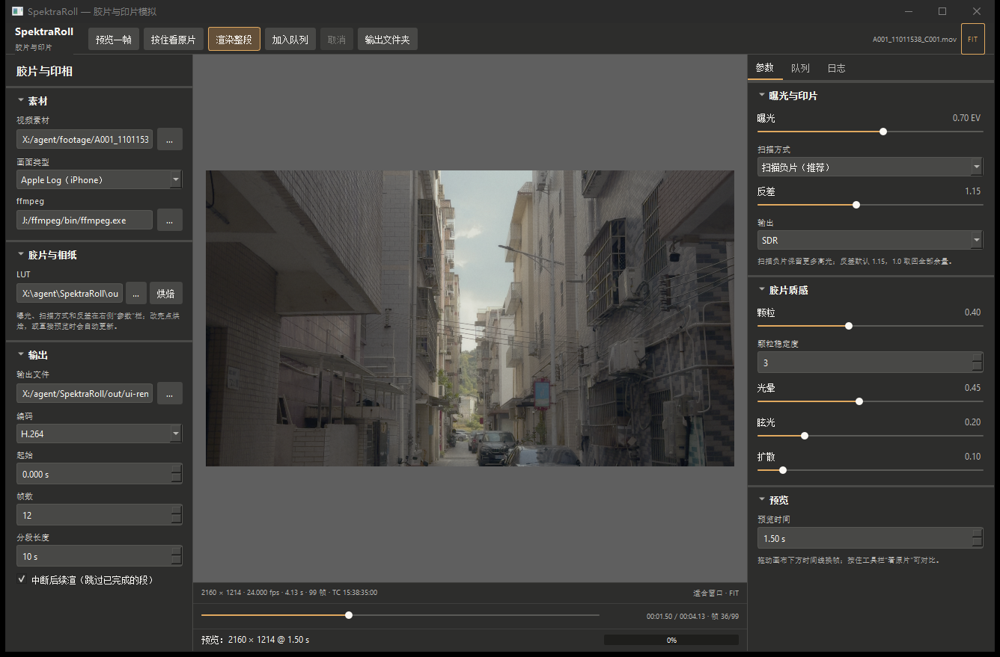
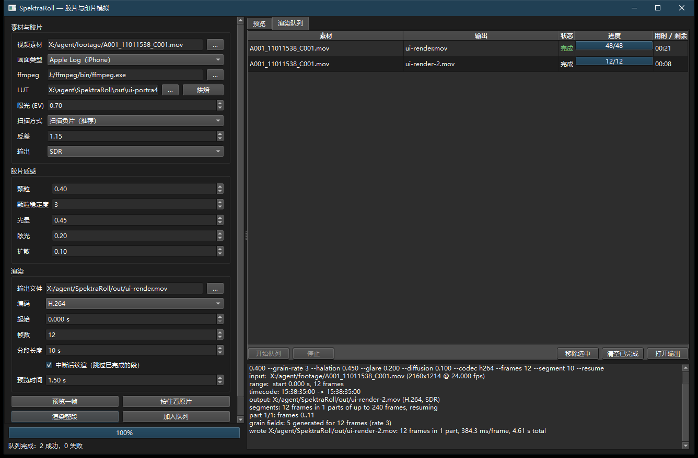

# STATUS

**最后更新**：2026-11-02 · 里程碑 **M5 启动（D009 = Qt 6）** · 项目名 **SpektraRoll**

## 一句话

`spektra-roll-cli video` 现在能直接吃 iPhone 的 **Apple Log** 视频：逐帧套 Portra 400 光谱 LUT，叠加颗粒、光晕、眩光、扩散，带原声输出 SDR 或 **HDR（PQ/HLG）**，也能直接出 ProRes 422 HQ。4 秒 99 帧素材约 35.5 秒跑完；长片可以分段渲染，中断后只补缺失的段，输出保留相机 timecode。现在也有 **Qt 6 桌面界面**：选素材、烘 LUT、调质感、预览一帧、渲染整段。

仓库：https://github.com/haichangjyue/SpektraRoll
本地：`X:\agent\SpektraRoll`

## M3 已完成：视频读写 + 胶片质感

- [x] `spektra-roll-cli video --lut x.cube --in clip.mov --out graded.mov [--trc pq]`
- [x] 逐帧解码 → 套 LUT → 重新编码，原声保留，HDR 自动带 PQ/HLG 标记
- [x] 自动处理竖拍素材的旋转（-90 元数据）
- [x] 帧区间：`--start 00:00:12 --frames 240`（音画同步）
- [x] ProRes 422 HQ 输出：`--codec prores`（SDR 和 HDR 都有）
- [x] macOS 本机验收脚本：`scripts/verify-macos.command`（**已在 Mac 上跑通，含视频路径**；期间发现并修复 POSIX `popen` 模式 bug）
- [x] 多线程（D032）：套 LUT 96→17 ms
- [x] **胶片质感**（D033/D035）：颗粒 + 光晕 + 眩光 + 扩散，逐帧叠加；`scripts\demo-m3.cmd`
- [x] 颗粒调轻（D034）：噪声 std 0.014→0.0053，不再"毛躁"（**已验收**）
- [x] **颗粒时间连续**（D036）：两场交叉淡化（`--grain-rate 3`），帧间差 −44%，视频不再闪烁
- [x] **模糊降采样**（D037）：眩光降 4 倍、光晕/扩散降 2 倍，579→469 ms/帧
- [x] **硬件编码选项**（D038）：`--encoder qsv`，2.6 MP 下收益有限（瓶颈在管道）
- [x] CI 现在 Windows + macOS 都跑视频冒烟
- [x] **颗粒场缓存**（D039）：一个噪声场跨帧复用，全质感 **476.5 → 358.7 ms/帧**
- [x] **分段渲染**（D040）：`--segment 10` 写成 `<out>.parts/`
- [x] **断点续渲**（D040）：`--resume` 只补缺失段；删掉中间段重跑验证过
- [x] **时间码**（D040）：复制源 timecode，`--start` 自动偏移；`--timecode` / `--no-timecode` 可覆盖
- [x] CI 两平台跑分段 + 时间码冒烟（Windows + macOS 绿）
- [x] 音频只在最后从源文件复制一次，分段边界没有 AAC 接缝
- [x] `scripts\demo-m4.cmd`：渲染 → 模拟崩溃 → 续渲
- [ ] 多段并行渲染

## M5 已开始：Qt 6 桌面界面（首版）

- [x] **D009 拍板 Qt 6**（Qt Widgets），不再走 WinUI 3 / MSVC
- [x] Qt 6.8.3 + MinGW 13.1 安装在 `X:\agent\tools\qt`（不进仓库）
- [x] `spektra-roll-ui`：素材、LUT、曝光、负片/印片、反差、SDR/HDR、颗粒/光晕/眩光/扩散
- [x] **预览一帧**：ffmpeg 抽帧 → 套 LUT + 质感 → 窗口显示（2160×1214 实测）
- [x] **时间线拖动**预览，素材信息条显示分辨率/帧率/时长/帧数/timecode
- [x] **按住看原片**对比、拖放素材、快捷键 Ctrl+P/R/B、输出文件夹
- [x] **烘焙 LUT** 按钮（Apple Log / SDR，HDR 自动带 PQ/HLG）
- [x] **渲染整段**：编码、起始、帧数、分段、续渲；日志、进度条、取消
- [x] **渲染队列**：参数冻结入队、自动避重名、顺序渲染、停止/移除/清空；LUT 快照保证已入队任务不被后续改参影响
- [x] 队列**持久化**（`out/ui-queue/queue.json`），重启后恢复；每行有进度条和用时/剩余时间；支持多文件拖入批量入队
- [x] `scripts\build-ui.cmd`：配置 → 编译 → windeployqt → 启动
- [x] 界面不复制管线，预览和渲染都调用同一个 `spektra-roll-cli`
- [x] 截图：`docs/ui-preview.png`
- [ ] 时间线拖动预览、批量队列、macOS 打包

## 这次交付（M1）

- [x] 导入 spektrafilm 的 Portra 400 / Portra Endura profile（CC BY-SA 4.0，已写署名）
- [x] C++ 实现最小光谱链：Mallett 上采样 → 灵敏度积分 → 特征曲线 → 印片 → 扫描
- [x] 印片机中性滤色片按上游数据库查表（0 / 51.568 / 52.534）
- [x] 烘焙真实 LUT：`lut bake`，33³ float32 `.cube`
- [x] parity harness：`lut compare`（PSNR + CIE76 ΔE），并冻结参考 LUT
- [x] 16-bit PNG 读写：`gen --bits 16`，`lut apply` 自动保持位深
- [x] 双击验收：`scripts\demo-m1.cmd`、`scripts\verify-m1.cmd`
- [x] 单元测试 4 个程序全绿（LUT / 胶片模型 / 图像 I/O / Apple Log）
- [x] 已推送 `main`，GitHub Actions Windows + macOS 双平台绿（CI 也会烘 LUT 并和参考对比）

## 这次交付（M2 · 已完成）

- [x] **Apple Log 输入**：`lut bake --input apple-log`，LUT 定义域就是 Apple Log 码值（D023）
- [x] Apple Log 解码和 colour-science 逐点一致：16-bit 输出误差 ≤ 1 LSB
- [x] `convert --from apple-log`：只解码、不上胶片的 SDR 对照图
- [x] **真实画面样张**：`scripts\demo-m2.cmd` 从你的 `.mov` 抽帧，出 before / 印片 / 负片 三张
- [x] **扫描负片模式**（D024）：`--scan negative`，天空从 0.88–0.91 变成 0.48–0.70（云有层次），暗部死黑 7.7%→2.5%
- [x] **负片为推荐路径**（D025），默认反差 **1.15**（D026，你确认）
- [x] **输出色域压缩**（D027）：OkLCh 色度压缩，Apple Log 印片负值 3,763→0，色相保持
- [x] **DIR 耦合剂**（D028）：Apple Log 默认开启，与上游参考 bake PSNR 80.75 dB
- [x] **HDR 输出**（D029）：PQ / HLG + 10-bit，白色默认 1000 nits；demo 出 HEVC 片段

## 怎么验收（M2）

1. 双击 `scripts\demo-m2.cmd` → 自动打开 `out\m2-negative.png`（负片，默认反差 1.15）和 `out\m2-negative-flat.png`（负片，不加反差）
2. 另外两张：`out\m2-before.png`（只解码）、`out\m2-after.png`（印片）
3. 看四件事：天空/窗户有没有层次、暗部有没有死黑、彩色招牌有没有串色、要留余量还是直接出片

## 实测数据（本机）

| 项 | 结果 |
|---|---|
| 编译器 | MinGW-w64 GCC 16.2.0 (ucrt, posix-seh) |
| 单元测试 | **6/6** 通过 |
| 33³ LUT 烘焙 | 108 ms（多线程）；单线程 198 ms |
| 2.6 MP 套 LUT（16-bit） | **17 ms**（多线程）；单线程 96 ms |
| 视频（2.6 MP，HEVC） | 无质感 187 ms/帧；全质感 **358.7 ms/帧**（缓存前 476.5）；4.1 s 素材约 35.5 秒 |
| 分段 / 续渲 | 4 s 素材 5 段；删第 4 段后续渲只花约 5 s，输出仍是 99 帧 / 4.125 s / 原声 / timecode |
| 颗粒时间稳定性 | 帧间差 0.0025（rate 1）→ **0.0014**（rate 3） |
| C++ vs Python 参考 | **PSNR 88.07 dB**，ΔE76 max 0.0065 |
| Apple Log 解码 vs colour-science | max 1.53e-5（16-bit 1 LSB），mean 1.9e-8 |
| 印片 vs 扫描负片（同一帧） | 天空 0.88–0.91 vs 0.48–0.70；暗部 <0.10：7.7% vs 2.5% |
| 负片反差 1.0 / 1.15 / 1.3 | 天空 p5–p95 0.48–0.70 / 0.49–0.75 / 0.49–0.79；暗部 2.5% / 6.8% / 13.1% |
| 可执行文件 | `build\spektra-roll-cli.exe`，静态链接 |

## 怎么验收（M1）

1. 双击 `scripts\verify-m1.cmd` → 最后应出现 `PASS: M1 全部检查通过.`
2. 双击 `scripts\demo-m1.cmd` → 自动打开 `out\m1-before.png` 和 `out\m1-after.png`
3. 看三件事：灰阶暗部是否偏暖、肤色是否自然、红蓝是否过饱和

## 下一步（M5）

1. **界面打磨**：时间线拖动预览、渲染队列、拖放素材
2. **真实点扩散核**：眩光 / 光晕 / 扩散现在是画幅比例 + 盒状模糊
3. **浮点 / EXR**（D017 欠账）
4. **并行的场生成**：颗粒噪声 + 模糊还是单线程，可再省几十毫秒
5. **多段并行渲染 / macOS Qt 打包**

## 需要你决定的事

- **D010**：OFX 插件做不做？（建议做，放第二期）
- **D011**：Apple Developer 账号什么时候买？（建议等有 Mac 再说）

> D009 已拍板：**Qt 6**（Qt Widgets），不用 WinUI 3。

## 风险 / 提醒

- macOS 已经本机验收过（MacBook Air M1），但**HDR 画面**只能在 iPhone 16 Pro 或 HDR 显示器上看。
- M1 的 LUT 是 display-encoded sRGB，不是线性/ACES；调色软件里要放在正确的色彩空间节点。
- 极端饱和输入会产生负的 LUT 值；Apple Log 路径已开 OkLCh 压缩，sRGB 路径仍靠钳制（保 parity）。
- 视频速度瓶颈在质感计算与管道，不在编码器；颗粒场缓存已做（D039），分段/续渲/时间码已做（D040）。
- Qt 界面不能只拷 exe：`build-ui` 里由 `windeployqt` 放好的 Qt DLL 和 `platforms\` 要一起带走（D009）。
